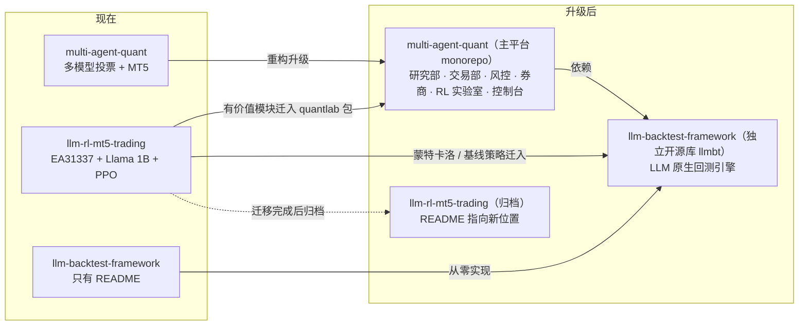
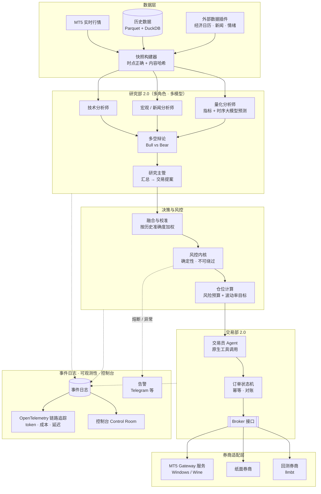
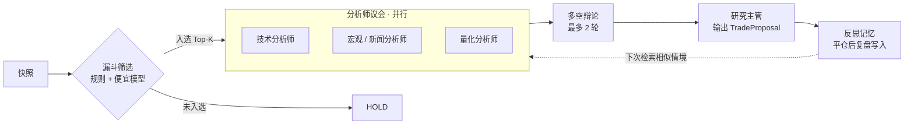
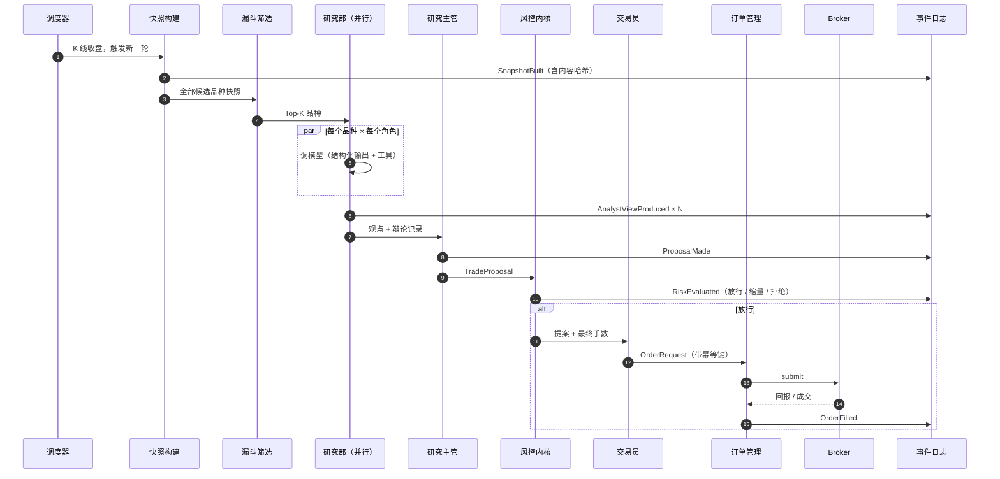

# 02 · 目标架构

[← 返回总览](README.md)

---

## 1. 设计原则

这八条是整个升级的"宪法"，后面所有设计都从这里推出来。

| # | 原则 | 落到实处是什么意思 |
|---|---|---|
| 1 | **LLM 出主意，代码握方向盘** | LLM 只输出观点和交易提案；下多少手、能不能下，由确定性的风控内核说了算。LLM 没有任何办法绕过风控。 |
| 2 | **回测和实盘跑同一套代码** | 决策流水线只认 `Snapshot → TradeProposal`，不关心数据来自实时行情还是历史回放。 |
| 3 | **一切皆事件，可回放、可审计** | 每次快照、每个模型的回答、每次风控判定、每笔成交都写进只追加的事件日志。UI、报表、归因、复盘全部从事件里推导。 |
| 4 | **模型、券商、数据源都是插件** | 换模型改一行配置；MT5 之外的券商实现同一个 `Broker` 接口即可接入。 |
| 5 | **先便宜后昂贵** | 漏斗式调用：先用规则 / 便宜模型筛品种，只有进入候选的才召集完整的"分析师议会"。 |
| 6 | **不信任 LLM 的输出** | 类型约束（Pydantic + 原生结构化输出）→ Schema 校验 → **接地校验**三层把关。接地校验的意思是：提案里引用的每个价位、每个数字，都必须能在快照里找到出处，找不到就拒绝。所有计算交给 Python，LLM 只负责推理和表达。 |
| 7 | **本地优先，单机能跑** | `docker compose up` 起整套；没有 MT5 也能用回放数据跑 demo。云服务全是可选项。 |
| 8 | **默认安全** | 默认 `dry_run`；真下单需要显式开关 + 二次确认；任何时候都能一键熔断。 |

---

## 2. 仓库重组方案

### 推荐方案 A：「一个平台 + 一个引擎」



**为什么这么分：**

- **multi-agent-quant 当主平台**：它最新、架构最清楚、已经能跑通完整链路，用它当底座最省力。
- **llm-backtest-framework 独立成库**：它是通用工具，不只服务你自己的系统。独立发 PyPI 更容易积累 star 和外部贡献，主平台作为它的第一个用户来"吃自己的狗粮"。
- **llm-rl-mt5-trading 拆分后归档**：它和主平台重复太多，而且主程序起不来。把有价值的部分（策略库、蒙特卡洛、资金分阶段管理、事件日历、告警、RL 骨架）迁走以后，留一个指路的 README 就够了。

### 备选方案 B：保持三个仓库，抽一个共享 `core` 包

如果你特别想保留三个独立仓库（比如各自当作品集展示），可以：三个仓库都依赖一个 `quant-core` 包（领域模型 + Broker 接口 + 事件定义）。缺点是三套 CI、版本要来回对齐，一个人维护会很累。**不推荐，除非有明确的展示需求。**

> 📌 这是第 0 阶段需要你拍板的第一个决策（ADR-001），详见 [总览 · 决策点](README.md#决策点)。

---

## 3. 总体架构



---

## 4. 分层设计

### 4.1 领域模型与事件（`maq-core`）

所有包共享一套 Pydantic v2 模型，彻底告别"每个仓库一个 `Signal` 类"。

```python
class AnalystView(BaseModel):
    """研究员的输出：只有观点，没有手数。"""
    stance: Literal["bullish", "bearish", "neutral"]
    conviction: float = Field(ge=0, le=1)
    regime: Regime                      # trending_up / trending_down / ranging / volatile
    horizon_minutes: int = Field(gt=0)
    key_levels: KeyLevels
    thesis: str                         # 一两句话的核心逻辑
    invalidation: list[str]             # 什么情况下观点作废
    evidence: list[EvidenceRef]         # 引用了快照里的哪些数据

class TradeProposal(BaseModel):
    """研究主管的输出：交易提案，同样没有手数。"""
    symbol: str
    side: Literal["BUY", "SELL", "FLAT"]
    conviction: float = Field(ge=0, le=1)
    entry: MarketEntry | LimitEntry
    stop_loss: Decimal                  # 价格，不是点数
    take_profit: Decimal | None
    ttl_minutes: int
    rationale: str
```

关键变化：**`volume` 字段从 LLM 的输出里彻底拿掉**。模型只表达"有多确信"（`conviction`），真正的手数由风控内核根据风险预算算出来。

事件是不可变的记录，统一带上 `cycle_id`、`ts`、`causation_id`，方便串起整条决策链：

`SnapshotBuilt` → `AnalystViewProduced` → `DebateTurn` → `ProposalMade` → `RiskEvaluated` → `OrderSubmitted` → `OrderFilled` → `PositionClosed` → `ReflectionWritten`

### 4.2 数据层（`maq-data`）

| 能力 | 方案 |
|---|---|
| 历史 K 线 / Tick | Parquet 分区存储（`symbol/timeframe/year`），DuckDB 直接查询，Polars 做计算 |
| 数据来源 | MT5 历史导出是主力：`copy_ticks_range` 能拿到券商自己的点差，回测成本要和实盘对得上就靠它；Dukascopy（`dukascopy-python`）提供免费的 bid/ask tick 作为补充。统一清洗成同一种格式 |
| 快照 | `SnapshotBuilder` 只能看到 `as_of` 时刻之前的数据（**代码层面杜绝前视偏差**），每个快照算内容哈希并落盘，LLM 的输入可以 100% 复现 |
| 外部数据 | 保留现有插件机制，升级成异步接口；首批插件：经济日历（从 llm-rl-mt5-trading 迁移）、新闻、情绪 |
| 指标 | TA-Lib 的新版本已经自带各平台 wheel，安装不再是痛点，常用指标直接用它；自定义指标用 Polars 实现 |

### 4.3 券商层（`maq-brokers`）与 MT5 Gateway

**核心思路：把"必须跑在 Windows 上的部分"压缩到最小。**

```text
┌──────────────── 任意平台（Linux / Docker / Mac）────────────────┐
│  主平台：研究部 · 风控 · 编排 · 控制台                            │
│        │  Broker 接口（异步）                                     │
│        ▼                                                          │
│  Mt5GatewayBroker ──── HTTP + WebSocket（带鉴权）───────┐         │
└─────────────────────────────────────────────────────────┼─────────┘
                                                          ▼
┌──────────── Windows VPS 或 Wine 容器 ─────────────────────────────┐
│  MT5 Gateway（一个很薄的 FastAPI 服务）                            │
│   · 独占 MetaTrader5 连接（单线程，避免进程级单例的并发问题）       │
│   · 断线重连、心跳、行情推送                                       │
│  MetaTrader 5 终端                                                │
└───────────────────────────────────────────────────────────────────┘
```

```python
class Broker(Protocol):
    async def account(self) -> Account: ...
    async def positions(self) -> list[Position]: ...
    async def symbol_spec(self, symbol: str) -> SymbolSpec: ...
    async def bars(self, symbol: str, tf: Timeframe, count: int) -> pl.DataFrame: ...
    async def submit(self, order: OrderRequest) -> OrderAck: ...     # 带幂等键
    async def cancel(self, order_id: str) -> None: ...
    def events(self) -> AsyncIterator[BrokerEvent]: ...              # 成交、持仓变化、断线
```

实现：`Mt5GatewayBroker`（实盘 / 模拟盘）、`PaperBroker`（本地撮合）、`BacktestBroker`（由 llmbt 驱动）、`FakeBroker`（测试用）。

所有实现共用一套**契约测试**：同一组测试用例跑在每个 Broker 上，保证行为一致。接口设计参考 NautilusTrader 的 adapter 模式——它是目前"回测和实盘同一套代码"做得最好的开源引擎。

**Gateway 的几个实现要点：**

- 官方 `MetaTrader5` 包目前是 5.0.6231（2026-09），只有 Windows x86-64 的 wheel，支持到 Python 3.14。
- 所有 MT5 调用都放进同一个工作线程（`asyncio.to_thread` 配单线程执行器），一个进程只连一个终端。
- 下单前先 `order_check` 再 `order_send`；用 `magic` + `comment` 编码幂等键；定期用 `positions_get` / `history_deals_get` 对账。

**在 Linux / Mac 上开发时**（阶段 2 的探索任务 P2-09 会给出结论）：

| 方案 | 说明 |
|---|---|
| MetaQuotes 官方 Wine 安装脚本 | 支持 Ubuntu / Debian / Fedora 等，官方维护 |
| mt5linux 1.1.x | 2026 年重新活跃，Wine + RPyC，能自己拉起 Docker 容器 |
| gmag11/MetaTrader5-Docker-Image | 带网页 VNC 和 RPyC 服务，仅支持 amd64 |
| siliconmetatrader5 | Apple Silicon 上用 Docker + QEMU 跑 |

建议：开发和 CI 用 Wine 方案连**模拟盘**；真金白银的账户继续放在 Windows VPS 上。

**MT5 之外的券商（P2，按需接入）：**

| 券商 / 接口 | 现状 | 备注 |
|---|---|---|
| cTrader Open API | 2025 年起支持原生 Python cBot，官方提供 Linux Docker 镜像 | 外汇方向上 MT5 最好的替代 |
| OANDA v20 | REST 和流式接口一直在用，但官方 Python SDK 多年没更新 | 自己用 httpx 写个薄客户端 |
| Interactive Brokers | `ib_async`（ib_insync 的继任者） | 需要常驻 TWS / IB Gateway |
| CCXT | 一套接口接入 100 多家加密货币交易所 | 想做加密货币时再接 |

### 4.4 研究部 2.0（`maq-agents`）

从"4 个模型回答同一个问题"升级成"**多角色分工 + 多模型混搭 + 有限轮辩论**"。



| 能力 | 说明 |
|---|---|
| **角色 × 模型矩阵** | 每个角色可以配置成任意模型。默认让不同厂商的模型担任不同角色，保留"模型多样性"这个原有优势 |
| **议会模式（兼容旧版）** | 同一个角色让 4 家模型都答一遍，再融合——相当于现在的玩法，保留为可选模式 |
| **原生结构化输出** | 直接用各家 API 的 JSON Schema / 结构化输出能力，正则提取和"让模型自己修 JSON"全部下线。OpenAI、Anthropic、Gemini 都支持严格模式；DeepSeek 目前只有 `json_object` 模式、不强制 Schema，所以对它保留"校验 + 重试一次"的兜底 |
| **原生工具调用** | 研究员可以按需调工具（拉更多 K 线、算指标、查日历），不再是把所有数据一股脑塞进 prompt |
| **反思记忆** | 参考 TradingAgents 的决策日志：每笔交易平仓后自动打分（R 倍数、相对基准的表现），再让模型写一段简短的复盘存进记忆库；下次遇到相似品种 / 行情时检索出来放进上下文 |
| **成本意识** | 每次调用记录 token、费用、延迟；静态的系统提示词和快照前缀走 prompt cache；每个角色单独设推理强度（effort）；回测场景走 Batch API 或低价档 |
| **Prompt 版本化** | prompt 文件带版本号，每次决策记录用的是哪个版本，方便 A/B 对比 |

#### 框架选型（ADR-002 的预案）

调研下来两条路都成立，**推荐方案 1**：

| | 方案 1：PydanticAI 2 + 自研轻量编排（推荐） | 方案 2：LangGraph 1.2 |
|---|---|---|
| 谁在用 | FinRobot V2 | TradingAgents、QuantAgent（现名 QuantHarness） |
| 结构化输出 | 原生 `output_type`，各家（含 DeepSeek）统一接口 | `with_structured_output`，经过 LangChain 的模型封装 |
| 断点续跑 / 回放 | 交给我们自己的领域事件日志（本来就要做） | 内置 checkpointer（SQLite / Postgres），能回放，也能从任意一步分叉 |
| 人工审批 | 可延迟执行的工具（deferred tools） | `interrupt()` |
| 测试 | 自带 TestModel / FunctionModel，单测不花钱 | 需要自己注入假模型 |
| 可观测性与成本 | 原生 OpenTelemetry，成本用 genai-prices 计算 | LangSmith 或 OpenTelemetry |
| 依赖 | 轻 | 要带上 langchain-core 一整套 |

推荐方案 1 的理由：

1. 我们的决策流程是一个固定的 DAG 加一段有限轮的辩论，用不上通用图引擎的大部分能力；
2. 领域事件日志本来就要做，而且要当唯一的事实来源，再引入 LangGraph 的 checkpoint 等于维护两套状态；
3. 回测时要逐根 K 线把整条流水线跑上万次，框架越薄，LLM 调用的录制回放越好控制。

什么时候改选方案 2：想直接复用 TradingAgents 的图结构和提示词，或者想用 LangGraph Studio 做可视化调试。

不管选哪个，底线都一样：**手数、风控、下单全部是确定性的 Python 代码，不进 LLM 的回路。**

### 4.5 融合与校准

现在的加权投票保留为基线，在此之上加四件事：

1. **置信度校准**：持续统计每个模型在每种行情（regime）下"说 0.8 的时候到底对了多少"，用 Brier 分数衡量，必要时做等渗回归校准。
2. **在线权重**：用 Hedge（乘法权重）算法按**已实现的成绩**动态调权重，取代现在的离线脚本和固定权重。
3. **分歧即信号**：模型之间分歧越大，仓位越小；分歧超过阈值直接 HOLD。
4. **分歧时辩论，而不是硬投票**：2026 年 8 月的研究（*Poisoning Agentic Alpha*）发现，多数投票会把被投毒的信号"焊死"。所以意见不一致时，改成"多空辩论 + 裁判"，由裁判逐条核对双方引用的证据；外部数据源（新闻、情绪）在进入快照前要标注来源，可疑内容做隔离。

### 4.6 风控内核（`maq-risk`）

**这是整个升级里优先级最高的部分。** 风控内核是纯函数、确定性的、不依赖任何 LLM。

```python
def evaluate(proposal: TradeProposal, ctx: RiskContext, limits: RiskLimits) -> RiskDecision:
    """输入提案和当前账户状态，输出：放行（附最终手数）/ 缩量 / 拒绝（附原因）。"""
```

| 关卡 | 检查内容 |
|---|---|
| **硬上限（写死在代码里）** | 单笔风险 ≤ 2%、最大手数、最大持仓数、最大回撤熔断。配置文件只能**往紧了调**，不能放宽 |
| **事前检查** | 必须有止损；止损距离合理（按 ATR 衡量）；风险回报比；点差 / 流动性；交易时段；**重大经济数据前后 N 分钟禁止开仓**；信号是否过期（TTL）；提案里的价格和现价偏离是否过大（防止模型编价位） |
| **仓位计算** | `手数 = 权益 × 单笔风险 × 置信度系数 × 回撤系数 ÷ (止损距离 × 每点价值)`，再按保证金、敞口、相关性逐级截断 |
| **组合层** | 同方向敞口、相关品种合并敞口、单币种净敞口 |
| **熔断器** | 当日亏损、账户回撤、API 错误率飙升、Schema 失败率飙升、LLM 日成本超预算——任意一个触发都自动暂停开新仓 |
| **人工急停** | 控制台按钮 / CLI 命令 / Telegram 指令，一键平仓或只停新开仓 |
| **能力分级的账户配置** | 借鉴 Vibe-Trading：每个券商连接都有明确的能力等级——`paper`（纸面）、`live-readonly`（实盘只读）、`live-trade`（实盘可交易）。实盘下单需要一份显式的**授权书（mandate）**，写明允许的品种、最大仓位、有效期 |
| **两种运行模式** | 借鉴 NOFX：**逐笔确认模式**（每笔交易推送到手机，人工点确认才下单）和**自动驾驶模式**。新策略一律先跑逐笔确认 |
| **分阶段放量** | 借鉴 llm-rl-mt5-trading 的 FundManager：纸面 → 模拟盘 → 小资金 → 正常仓位，每一级都要达到上线门槛才能升级 |
| **防篡改审计账本** | 借鉴 ai-hedge-fund：每条决策和订单记录都带上前一条的哈希，形成哈希链，事后无法悄悄改写 |

所有关卡都用 **Hypothesis 做性质测试**，比如"不管输入是什么，最终风险永远不超过上限"。

### 4.7 交易部 2.0 与订单管理

- 交易员 Agent 改用**原生工具调用**，工具通过 MCP 暴露（见 4.8）。
- 交易员只能"提交订单请求"，请求会先过风控内核，再进订单状态机：`NEW → SUBMITTED → PARTIALLY_FILLED → FILLED / REJECTED / CANCELLED`。
- **先落盘、再发送**：订单请求先持久化到事件日志，确认写入成功后才发给券商。进程在任何时刻崩溃，重启后都能知道"哪些单发出去了、哪些还没有"。
- 每个订单带**幂等键**（`cycle_id + symbol + side`），断线重试不会重复下单。
- 后台**对账循环**：定期比对本地状态和券商实际持仓，发现"孤儿仓位"立即告警。

### 4.8 MCP 服务（`maq-mcp`）

先说一个新情况：**MT5 终端从 build 6060（2026 年 7 月）起自带 MCP Server**（在"工具 › 选项 › MCP"里开启，默认监听 `127.0.0.1:22346`，用 API key 鉴权），外部 AI 助手可以直接连上去查行情，甚至管理订单。所以"MT5 原子操作"这一层不用我们自己包了。

两者的分工：

| | MT5 自带的 MCP | 我们的 `maq-mcp` |
|---|---|---|
| 定位 | 终端级的原子操作 | 平台级能力 |
| 工具 | 行情、账户、订单等 | 决策历史、某一轮议会的完整记录、风控状态、绩效与成本统计、`propose_order`（走风控） |
| 用途 | 运维和研究时临时查询 | Agent 的标准工具集；你也可以在 Claude Desktop / Claude Code 里直接"和自己的交易系统对话"，比如问"今天为什么没开 EURUSD" |
| 能不能下单 | **系统里禁用它的下单工具** | 只能提交提案，最后由风控内核决定 |

原则只有一条：**任何下单都必须经过风控内核**，不管请求来自哪个 Agent、哪个客户端。

### 4.9 编排与调度

- **asyncio 全异步**：同一轮里多个品种、多个模型并行，配合按厂商的并发上限和限速。
- **按 K 线收盘对齐的调度器**：M15 周期就在每个 15 分钟整点后几秒触发，周末和休市自动跳过。
- **单轮超时与降级**：某个模型超时就按"休假"处理，不拖累整轮。
- **崩溃恢复**：每一步结果都写进事件日志，进程重启后从断点继续，不会重复下单。

### 4.10 存储

| 数据 | 方案 | 理由 |
|---|---|---|
| 事件日志、订单、状态 | SQLite（WAL 模式），可选 Postgres | 单机够用，零运维 |
| 行情、分析数据 | Parquet + DuckDB | 列存，分析查询快；DuckDB 2.0 是长期支持版（至少支持到 2027 年 10 月） |
| 记忆库（向量检索） | sqlite-vec 或 LanceDB | 嵌入式，不需要额外服务 |
| LLM 调用缓存 | SQLite，以请求哈希为键 | 回测回放、开发调试都靠它 |

### 4.11 可观测性

- **链路追踪**：OpenTelemetry，按 GenAI 语义约定打点（这套约定目前还标着 Development，但主流工具都已经支持）。一轮决策 = 一条 trace，里面每次模型调用、工具调用、风控判定、下单都是 span。
- **LLM 观测平台**：Langfuse v4（核心是 MIT 许可，可自托管），看每次调用的 prompt、回答、token、成本、延迟，也能管理 prompt 版本、做评测数据集。
- **结构化日志**：structlog 输出 JSON。
- **告警**：Telegram（从 llm-rl-mt5-trading 迁移并加上 `/status`、`/pause`、`/kill` 指令）。

### 4.12 API 与控制台

- **后端**：FastAPI，REST + WebSocket 推送实时事件。
- **前端**：详见 [05 · 美化与体验](05-ux-and-branding.md)。

---

## 5. 一轮决策的完整时序



---

## 6. 目标目录结构

```text
multi-agent-quant/
├── pyproject.toml                 # uv workspace 根
├── uv.lock
├── packages/
│   ├── maq-core/                  # 领域模型、事件、配置、时钟
│   ├── maq-data/                  # 行情存储、快照、外部数据插件、指标
│   ├── maq-brokers/               # Broker 接口 + MT5 Gateway 客户端 / Paper / Fake
│   ├── maq-agents/                # 研究部、交易部、prompt、记忆、模型路由
│   ├── maq-risk/                  # 风控内核、仓位计算、熔断
│   ├── maq-engine/                # 编排、调度、订单管理、对账
│   ├── maq-mcp/                   # MCP Server
│   ├── maq-quantlab/              # 来自 llm-rl-mt5-trading：经典策略、RL、优化器
│   └── maq-server/                # FastAPI + WebSocket
├── services/
│   └── mt5-gateway/               # 跑在 Windows / Wine 上的薄服务（独立打包）
├── apps/
│   ├── cli/                       # `maq` 命令：run / backtest / demo / doctor / replay
│   └── web/                       # 控制台前端
├── configs/
│   ├── default.yaml
│   └── examples/                  # demo / paper / live 三套示例
├── prompts/                       # 版本化的 prompt 模板
├── docs/                          # 文档站源码（中英双语）
├── docker/
│   └── compose.yaml               # 平台 + Langfuse + 控制台
└── tests/
    ├── unit/
    ├── contract/                  # Broker 契约测试
    ├── property/                  # Hypothesis 性质测试
    ├── cassettes/                 # 录制的 LLM 调用
    └── e2e/                       # 用回放数据跑完整一轮
```

---

## 7. 技术选型总表

| 领域 | 首选 | 备选 | 选择理由 |
|---|---|---|---|
| Python 版本 | **3.13** | 3.14 | MT5 官方包支持到 3.14；PydanticAI 2 和 google-genai 2 要求 ≥ 3.11；NautilusTrader v2 要求 ≥ 3.13。3.13 是各方最稳的交集 |
| 包管理 | **uv**（workspace + lockfile，`uv_build` 后端） | — | 快，monorepo 支持好，已经是事实标准 |
| Lint / 格式化 | **Ruff**（替代 black + flake8） | — | 一个工具全包 |
| 类型检查 | **Pyrefly 或 mypy**（CI 门禁）+ basedpyright（编辑器） | Astral `ty` | Pyrefly 2026 年 5 月发布 1.0，速度快；`ty` 还在 beta，稳定后可以考虑统一 |
| Git hooks | **prek** | pre-commit | Rust 实现，直接读现有的 pre-commit 配置，更快 |
| 数据模型与配置 | **Pydantic v2 + pydantic-settings** | — | 和结构化输出天然契合 |
| Agent 框架 | **PydanticAI 2**（单个 Agent）+ 自研轻量编排 | LangGraph 1.2 | 见 4.4 节的"框架选型" |
| 模型接入 | PydanticAI 内置的多厂商接入（含 DeepSeek），成本用 genai-prices 计算 | LiteLLM / Portkey / OpenRouter | 先不加网关，真需要集中管 key 和预算时再加。**依赖必须带哈希锁定**：LiteLLM 在 2026 年 3 月出过供应链投毒事件 |
| 工具协议 | **MCP**（2026-07-28 版规范） | — | 行业标准。新规范改成了无状态，旧的 HTTP+SSE 传输已经弃用，用 stdio 或 Streamable HTTP |
| 崩溃恢复 | 自研事件日志 + 幂等键 | DBOS | DBOS 只是一个跑在 SQLite / Postgres 上的库，单机也能用，需要时再加 |
| 数值计算 | **Polars** + NumPy | pandas 3 | 更快。注意 Polars 2.0 有些不声不响的行为变化（比如 join 不再保证行序），升级时要跑全量测试 |
| 分析存储 | **DuckDB 2.0（LTS）+ Parquet** | QuestDB（tick 量很大时） | 嵌入式，零运维；ArcticDB 改成了 BSL 许可，生产环境要付费 |
| 状态存储 | **SQLite (WAL)** | Postgres | 单机够用 |
| 统计检验 | **skfolio**（walk-forward、组合清洗交叉验证）、**RiskLabAI**（PBO、DSR）、**arch**（SPA、MCS 多重检验） | — | mlfinlab 已经闭源 |
| 绩效报告 | **quantstats**（2026 年重新活跃） | pyfolio-reloaded | — |
| Web 后端 | **FastAPI** | Litestar | 生态最大 |
| 前端 | **Next.js + shadcn/ui + Tailwind + TradingView Lightweight Charts v5** | NiceGUI（纯 Python） | 详见 [05 · 美化与体验](05-ux-and-branding.md) |
| 研究看板 | **marimo + Streamlit** | — | 一个做交互式分析，一个做内部看板 |
| 可观测性 | **OpenTelemetry + Langfuse v4** | Pydantic Logfire（托管）、Arize Phoenix | Langfuse 核心是 MIT、可自托管；Phoenix 是 Elastic-2.0 许可，不算严格意义上的开源 |
| 评测 | **promptfoo** 或 Inspect AI | Pydantic Evals、DeepEval | promptfoo 方便用同一组用例横向跑四家模型 |
| 日志 | **structlog** | — | JSON 结构化 |
| CLI | **Typer + Rich** | Textual（能 SSH 上去用的运维终端） | 好写、好看 |
| 测试 | pytest、Hypothesis、pytest-xdist、inline-snapshot、pytest-recording（录制 LLM 的 HTTP 调用） | — | 见 [03 · 分阶段任务](03-phases.md) 的测试策略 |
| 任务编排 | **nox** | just | — |
| 文档 | **Zensical**（中英双语） | Material for MkDocs | Zensical 是 Material for MkDocs 团队的新项目，后者已经进入维护模式 |
| 容器 | Docker 多阶段构建（直接从 uv 官方镜像拷贝二进制） | — | — |
| CI | GitHub Actions（Ubuntu + Windows），用 zizmor 检查 workflow 安全，action 按 commit SHA 固定 | — | Windows 任务专门测 Gateway |
| 发布 | release-please + PyPI Trusted Publishing | commitizen | — |
| 依赖更新 | **Renovate** | Dependabot（已正式支持 uv） | — |

> 各项的版本号和最新动态见 [04 · 开源灵感地图](04-inspiration.md)。

---

## 8. 新配置长什么样

七个零散的 YAML 合并成一个分层配置，用 Pydantic 做校验，拼错键名会直接报错。

```yaml
# configs/default.yaml
mode: paper                      # demo | paper | live；live 需要额外的环境变量确认

schedule:
  timeframe: M15
  universe: [EURUSD, GBPUSD, USDJPY, XAUUSD]
  funnel_top_k: 5                # 每轮最多召集议会讨论几个品种

models:                          # 模型注册表：在这里填各家当前的模型 ID
  fast:  { provider: deepseek,  model: "<填写>" }
  smart: { provider: anthropic, model: "<填写>" }
  alt1:  { provider: openai,    model: "<填写>" }
  alt2:  { provider: google,    model: "<填写>" }

roles:                           # 角色 × 模型矩阵
  technical_analyst: smart
  macro_analyst: alt2
  quant_analyst: alt1
  bull_researcher: smart
  bear_researcher: alt1
  research_manager: smart
  trader: fast
  council_mode: false            # true = 每个角色让所有模型都答一遍

risk:                            # 只能比代码里的硬上限更严
  per_trade_risk: 0.01
  daily_loss_limit: 0.03
  max_drawdown_halt: 0.50        # 沿用现有设计；配合下面的分级降仓一起生效
  drawdown_throttle: { 0.10: 0.75, 0.25: 0.50, 0.40: 0.25 }
  news_blackout_minutes: 30

budget:
  llm_daily_usd: 5.0             # 超预算自动降级为只用 fast 模型
```
