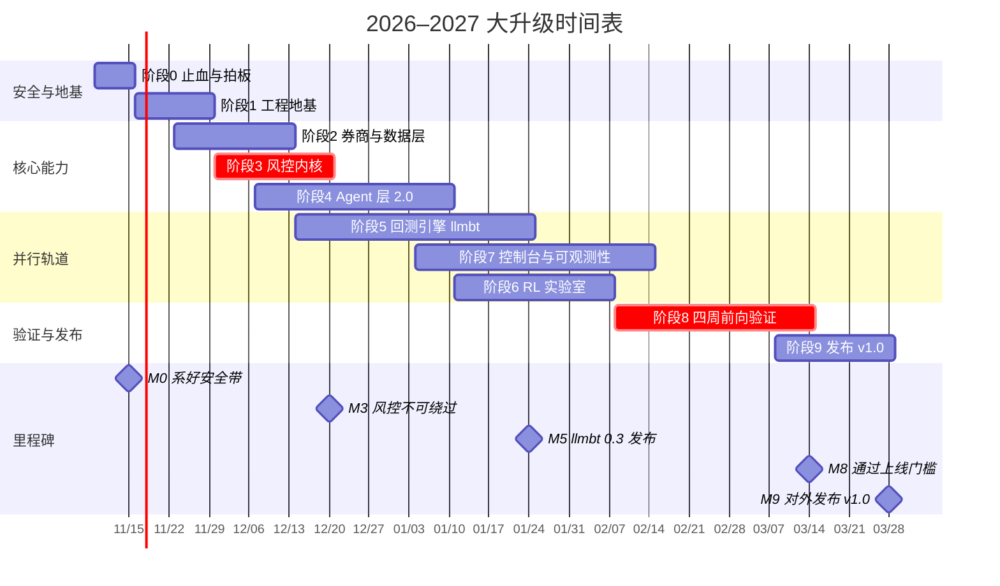

# 2026 大升级计划

> 覆盖三个仓库：**multi-agent-quant**、**llm-rl-mt5-trading**、**llm-backtest-framework**
> 编写日期：2026-11-03 ｜ 状态：执行中（ADR-0001～0004 已于 2026-11-03 拍板）

---

## 一页纸摘要

**为什么要升级**

- **安全带没系。** multi-agent-quant 默认配置下三层风控没生效，下单手数由 LLM 直接决定，主循环还写死了真下单。
- **地基不稳。** llm-rl-mt5-trading 主程序起不来、依赖装不上；三个仓库都没有 CI，覆盖率最高的也只有 23%。
- **外部环境变了。** 你在用的 DeepSeek V3.2 正在被各家下线；2025–2026 年冒出来一批很好的开源项目和研究结论（结构化输出、MCP、防前视偏差、多数投票会被投毒……），现在的架构一条都没吃到。

**升级后长什么样**

- **一个平台 + 一个引擎**：multi-agent-quant 升级成 monorepo 主平台，llm-backtest-framework 做成独立开源的 `llmbt` 回测库，llm-rl-mt5-trading 拆分迁移后归档。
- **LLM 出主意，代码握方向盘**：多角色、多模型的研究部会辩论、会复盘，但手数和能不能下单，由一个确定性、不可绕过的风控内核说了算。
- **回测说真话**：回测和实盘跑同一套代码，记录每一次 LLM 调用，计入成本和延迟，核心指标只看模型知识截止日之后的区间。
- **看得见、摸得着**：八页控制台 + Telegram 机器人 + MCP，没有 MT5 和 API key 也能两分钟跑起 Demo。

**怎么做**：10 个阶段、约 20 周（每周 20 小时左右），**先安全、再地基、后功能**。时间紧的话有 8 周的精简路线。

---

## 进度记录

| 日期 | 阶段 | 完成了什么 | 仓库 |
|---|---|---|---|
| 2026-11-03 | 0 | **风控默认生效**：`enforcement.enabled`、`enforce_safety` 打开；手数改为按风险预算计算，LLM 提议的手数只能调小（P0-02、P0-15） | multi-agent-quant |
| 2026-11-03 | 0 | **去掉写死的真下单**：主循环默认 dry run，只有加 `--live` 才发单（P0-03） | multi-agent-quant |
| 2026-11-03 | 0 | **修复融合结果被绕过的 bug**：此前"两多两空"或"3/4 行情判断不一致"时融合结果是 HOLD，但系统仍按某个模型的 BUY 下单（P0-14） | multi-agent-quant |
| 2026-11-03 | 0 | 更新过时的 `AGENTS.md`、README 和运维文档里的实盘说明（P0-09）；测试从 31 个增加到 48 个，全部通过 | multi-agent-quant |
| 2026-11-03 | 0 | 重写损坏的 `monitoring.py` 和告警测试，删除无法恢复的示例；修好依赖文件、异常装饰器 bug、pandas 3 兼容问题，补 LICENSE（P0-04～P0-07）。同一环境下测试从 496 通过 / 81 失败变成 600 通过 / 15 失败，剩余失败均为原有问题，已在迁移计划里逐条说明 | llm-rl-mt5-trading |
| 2026-11-03 | 0 | README 不再宣称尚不存在的集成，加上 pre-alpha 标识；修好 `CONTRIBUTING.md`（P0-08） | llm-backtest-framework |
| 2026-11-03 | 1 | **工程地基**：uv workspace + 锁文件；Ruff 接管 lint 和格式化；新包 strict mypy；GitHub Actions（Ubuntu + Windows）、Dependabot、pre-commit；requirements 改为从锁文件导出（P1-01～P1-05、P1-13） | multi-agent-quant |
| 2026-11-03 | 1 | **maq-core**：7 个配置文件的严格校验、代码里的风险硬上限、`MAQ_*` 环境变量覆盖、`--live` 安全门槛；structlog 结构化日志（P1-07、P1-08） | multi-agent-quant |
| 2026-11-03 | 1 | **maq 命令**：`maq doctor`、`maq config validate`、`maq config show`（P1-09） | multi-agent-quant |
| 2026-11-03 | 1 | **测试基建与补测**：假 MT5 终端、假 OpenAI 兼容服务、Hypothesis；下单执行器、交易部、DeepSeek 客户端从 0% 覆盖到 74%～96%，测试 48 → 162 个（P1-10） | multi-agent-quant |
| 2026-11-03 | 1 | **动手时修掉的真实 bug**：filling 模式位掩码误用（"Unsupported filling mode" 拒单的根源）；交易部能下研究部没让下的单；`NaN` 绕过范围检查；手数四舍五入超出风险预算；CLI 分析师临时文件泄漏（P1-14～P1-16） | multi-agent-quant |
| 2026-11-03 | 1 | 6 篇 ADR：仓库结构、Agent 框架、控制台、MT5 部署 4 篇按建议方案拍板（补充：暂时不在 Windows 上跑），另 2 篇记录本轮已做的决定（P0-10） | multi-agent-quant |
| 2026-11-03 | 2 | **领域模型与券商层**：`maq-core` 加上领域模型、事件注册表、时钟；新包 `maq-brokers`：统一的异步 `Broker` 接口、`PaperBroker`（滑点、手续费、隔夜利息、挂单、保证金、强平）、24 项契约测试（P1-06、P2-01、P2-04） | multi-agent-quant |
| 2026-11-03 | 2 | **MT5 适配器与 Gateway**：`Mt5Broker`（单线程、幂等键写进 comment、`order_check` 先行、事件从成交记录推导）、`services/mt5-gateway`（FastAPI + token + 长轮询）、`Mt5GatewayBroker` 客户端。按拍板意见没上 Windows：写了一个独立的模拟交易服务器，契约测试在三条链路上全部通过（P2-02、P2-03 代码部分，ADR-0007） | multi-agent-quant |
| 2026-11-03 | 3 | **风控内核** `maq-risk`：20 多道事前检查、仓位计算器、熔断器、急停、授权书；每项检查正反测试，3 条性质各跑 10 万个随机样例 0 反例，覆盖率 99%（P3-01～P3-05、P3-09、P3-10，ADR-0008） | multi-agent-quant |
| 2026-11-03 | 3 | **事件日志与订单管理** `maq-engine`：SQLite 哈希链事件日志（`maq audit verify` 能发现任意一条被篡改）、先落盘再发送的订单管理器、对账、从提案到成交的执行流水线（P3-06、P3-12） | multi-agent-quant |
| 2026-11-03 | 3 | **动手时修掉的真实 bug**：旧代码把日亏损限额（比例 0.03）和金额比较，亏 4 美分就停一天，入金还被算成当日盈利；`order_send` 没回应时会换个 filling 模式重发，可能下出两笔单。`maq kill-switch` 也接进了旧主循环 | multi-agent-quant |

**阶段 0 还剩**：P0-01（打 `v0-legacy` 标签）、P0-11（采集基线，需要在 Windows + MT5 上跑一周，按拍板意见先缓一缓）、P0-12（确认 DeepSeek 端点，需要 API key）、P0-13（CLI 换成原生 Schema 参数，需要在装了三个 CLI 的机器上验证）。

**阶段 1 还剩**：gitleaks 和 zizmor 接入 CI、文档站和 Docker（已推迟，见上表）。

**阶段 2 还剩**：历史数据管道、`SnapshotBuilder` v2、指标统一、外部数据异步化（P2-05～P2-08），Linux 跑 MT5 的调研（P2-09）；Gateway 和客户端在真实终端上的验收等上了 Windows 再做。

**阶段 3 还剩**：Telegram 急停和逐笔确认（P3-05、P3-11）、能力分级配置（P3-10）、分阶段放量和移动止损（P3-07、P3-08，迁移旧仓库的模块）；熔断器的数据来源要等阶段 4 的 Agent 层。新内核还没有接管旧主循环的下单路径，阶段 4 迁移时先并行对比两边的判定。

---

## 文档导航

| 文档 | 内容 |
|---|---|
| [01 · 现状体检报告](01-audit.md) | 三个仓库的问题清单，每条都有证据和复现命令 |
| [02 · 目标架构](02-target-architecture.md) | 设计原则、仓库重组、分层设计、目录结构、技术选型 |
| [03 · 分阶段任务清单](03-phases.md) | 10 个阶段、近百个任务，每个都有优先级、工作量和验收标准 |
| [04 · 开源灵感地图](04-inspiration.md) | 调研过的项目、论文、工具，以及我们具体借了什么 |
| [05 · 美化与体验](05-ux-and-branding.md) | 控制台设计、README 改版、品牌统一、Demo 模式 |
| [llm-rl-mt5-trading 迁移计划](https://github.com/Caesarcph/llm-rl-mt5-trading/blob/main/docs/UPGRADE_PLAN.md) | 每个模块的去留、RL 怎么重新定位、归档步骤 |
| [llm-backtest-framework 路线图](https://github.com/Caesarcph/llm-backtest-framework/blob/master/ROADMAP.md) | llmbt 的定位、竞品分析、架构、版本计划 |

---

## 升级前后对比

| 维度 | 现在 | 升级后 |
|---|---|---|
| 仓库 | 3 个，大量重复；一个起不来，一个只有 README | 1 个平台 monorepo + 1 个独立的回测库 |
| 调用 LLM | CLI 子进程 + 正则提取 JSON + 让模型自己修 | 原生 API + 结构化输出 + 原生工具调用 |
| 研究员 | 4 个模型回答同一个问题，然后投票 | 多角色分工 + 多模型混搭 + 分歧时辩论 + 复盘记忆 |
| 风控 | 默认关闭，手数由 LLM 决定 | 确定性内核，不可绕过；授权书、急停、熔断、分阶段放量 |
| 执行 | 串行，每一步都重连 MT5 | 全异步；MT5 Gateway 常驻；订单先落盘再发送 |
| 回测 | 信号回放，不计成本，不管前视偏差 | llmbt：调用账本、成本、延迟、截止日防护、多次重采样 |
| 可观测性 | 翻 JSON 日志 | 每轮决策一条完整 trace，token、成本、延迟一目了然 |
| 界面 | 没有 | 八页控制台 + Telegram 机器人 + MCP |
| 开发平台 | 只能在 Windows 上 | 任意平台开发，只有 Gateway 需要 Windows |
| 工程化 | 没有 CI、没有锁文件、覆盖率 23% | uv + Ruff + 类型检查 + 双平台 CI，核心覆盖率 80% 以上 |
| 上手门槛 | Windows + MT5 + 4 个 CLI 全部配好 | `docker compose up`，两分钟看 Demo |

---

## 时间表

> 按自然周排，从 2026-11-09（周一）开始，**没扣节假日**。圣诞、元旦和 2027 年春节（2 月 6 日前后）期间大概率会顺延 1–2 周。

## 里程碑

| 里程碑 | 时间 | 完成的标志 |
|---|---|---|
| **M0 · 系好安全带** | 第 1 周末 | 旧系统默认配置下"不会闯祸"；四个关键决策已拍板 |
| **M1 · 现代化工程骨架** | 第 3 周末 | `uv sync` 一条命令装好；CI 全绿；旧功能一个没丢 |
| **M2 · 脱离 Windows 开发** | 第 5 周末 | 在 Mac / Linux 上用纸面券商 + 历史数据就能完整开发和测试 |
| **M3 · 风控不可绕过** | 第 6 周末 | 风控包覆盖率 ≥ 95%；"LLM 要求 10 手、不设止损"的提案被正确拒绝或截断 |
| **M4 · 研究部 2.0 上线** | 第 9 周末 | 5 个品种跑一轮完整议会 p95 < 90 秒；Agent 测试在 CI 里零 API 花费 |
| **M5 · llmbt 0.3 发布** | 第 11 周末 | 主平台每次改策略都能先回测再上线 |
| **M6 · 旧仓库归档** | 第 13 周末 | llm-rl-mt5-trading 的有效模块全部迁移完 |
| **M7 · 控制台可用** | 第 14 周末 | 实时看到一轮决策从快照到成交的全过程；Demo 能拿去演示 |
| **M8 · 通过上线门槛** | 第 18 周末 | 模拟盘连续 4 周可用率 ≥ 99%、零重复下单、故障演练全部通过 |
| **M9 · 对外发布 v1.0** | 第 20 周末 | 新用户从零到跑通 Demo 不超过 10 分钟 |

---

## 决策点

第 0 阶段需要你拍板的事，每一项都会写成一篇 ADR（架构决策记录）放在 `docs/adr/`。
前四项已于 2026-11-03 按推荐方案拍板，另外补充了一条：**暂时不在 Windows 上跑**，MT5 相关部分先用假终端开发和测试。

| 编号 | 要决定什么 | 推荐 | 备选 | 什么时候定 |
|---|---|---|---|---|
| ADR-001 | 仓库结构 | **一个平台 + 一个引擎**：llm-rl-mt5-trading 拆分迁移后归档 | 保留三个仓库，抽一个共享的 core 包 | ✅ 已定 |
| ADR-002 | Agent 框架 | **PydanticAI 2 + 自研轻量编排** | LangGraph 1.2（想复用 TradingAgents 的图结构时选它） | ✅ 已定 |
| ADR-003 | 控制台技术栈 | **Next.js + shadcn/ui**，正式版出来之前先用 Streamlit 过渡 | NiceGUI（纯 Python） | ✅ 已定 |
| ADR-004 | MT5 部署方式 | **Windows VPS 跑 Gateway**；开发和 CI 用 Wine 方案连模拟盘 | 全部跑在 Wine / Docker 里 | ✅ 已定（暂不上 Windows） |
| ADR-005 | 默认模型组合与 LLM 预算 | 你来定。建议先设每日上限（比如 5 美元），超了自动降级成只用快速档 | — | 第 5 周前 |
| ADR-006 | 要不要接第二家券商 | 先不接，接口留好 | cTrader（外汇方向最好的替代）/ OANDA | 第 13 周以后 |

---

## 风险与对策

| 风险 | 可能性 | 影响 | 对策 |
|---|---|---|---|
| 一个人精力不够，战线拉太长 | 高 | 高 | 每个阶段都有能独立交付的成果；阶段 5、6、7 可以往后推；有 8 周精简路线 |
| 重构期间旧系统用不了 | 中 | 中 | 旧代码先整体搬进 `maq-legacy` 保持能跑；三个仓库都打 `v0-legacy` 标签 |
| LLM 成本失控 | 中 | 中 | 每日预算 + 超预算自动降级 + 漏斗筛选 + prompt 缓存 + 回测走 Batch API |
| 模型下线或改名（比如这次的 V3.2） | 高 | 中 | 模型 ID 全部放进配置；每季度检查一次；至少两家厂商互为备份 |
| 回测结果过于乐观 | 高 | 高 | 截止日防护，核心指标只看截止日之后；DSR / PBO；四周前向验证 |
| MT5 或券商接口变化 | 中 | 中 | Gateway 隔离变化；契约测试；每晚跑一次集成测试 |
| 依赖被投毒（供应链攻击） | 低 | 高 | `uv.lock` 带哈希、Renovate 升级要人工审、gitleaks、能不加的依赖就不加 |
| 外部数据被投毒 / 提示注入 | 中 | 高 | 数据标注来源并隔离可疑内容、分歧时辩论 + 裁判、接地校验 |
| 新版本变化太快（Polars 2、NautilusTrader v2 还在 rc） | 中 | 低 | 锁版本；升级前跑全量测试；NautilusTrader 只做可选后端 |
| 过度工程 | 中 | 中 | 每个 P2 任务开工前先问一句"不做会怎样" |

---

## 成功指标

| 指标 | 现在 | 目标 |
|---|---|---|
| 单轮决策耗时（5 个品种） | P0-11 实测 | p95 ≤ 90 秒 |
| 模型输出解析失败率 | P0-11 实测 | ≤ 0.5% |
| 每次决策的成本能不能查到 | 不能 | 100% 能查 |
| 测试覆盖率 | 约 23% | 核心包 ≥ 80%，风控包 ≥ 95% |
| 能绕过风控的路径 | 好几条（见 01） | 0 |
| 能在 Linux / Mac 上开发 | 不能 | 能 |
| 新人跑通 Demo | 几乎不可能 | ≤ 10 分钟 |
| 回测可复现 | 不能 | 同样的缓存，结果完全一致 |
| 前向验证期可用率 | — | ≥ 99% |

---

## 第一周就能动手的 10 件事

1. 三个仓库各打一个 `v0-legacy` 标签。
2. 把 `risk_config.yaml` 和 `execution_config.yaml` 里的 4 个开关改成安全的默认值（P0-02）。
3. 删掉 `scripts/run_loop.py` 里写死的 `dry_run = False`，改成 `--live` 参数（P0-03）。
4. 确认 NVIDIA 端点上的 DeepSeek V3.2 还能不能用，准备切到 V4（P0-12）。
5. 给三个 CLI 加上原生 Schema 参数，先把 JSON 解析失败率压下来（P0-13）。
6. 在 multi-agent-quant 上跑一次 `ruff check --fix`，一口气清掉 738 个可自动修的问题。
7. 修好 llm-rl-mt5-trading 的三个损坏文件和 `requirements.txt`（P0-04、P0-05）。
8. 给 llm-rl-mt5-trading 补上 LICENSE。
9. 把 llm-backtest-framework README 里那些"✅ Built-in"改成"🔜 Planned"。
10. 写完 ADR-001 到 ADR-004。

---

## 怎么用这份计划

- **变成 Issue**：03 文档里每一行任务都可以原样变成一个 GitHub Issue，任务 ID 当标题前缀，验收标准当完成定义。
- **建一个看板**：用 GitHub Projects 建四列：待办 / 本周 / 进行中 / 完成，标签按 `phase:*`、`priority:*` 区分。
- **每周复盘 30 分钟**：看里程碑进度、更新这份计划；`PROGRESS.md` 的检查点记录方式可以保留，以后由 CHANGELOG 自动生成。
- **计划不是合同**：遇到新情况（比如又有模型下线、又冒出好项目），直接改这几份文档，在 PR 里说明为什么改。
